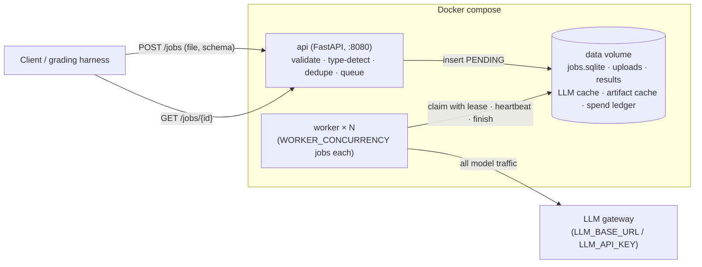
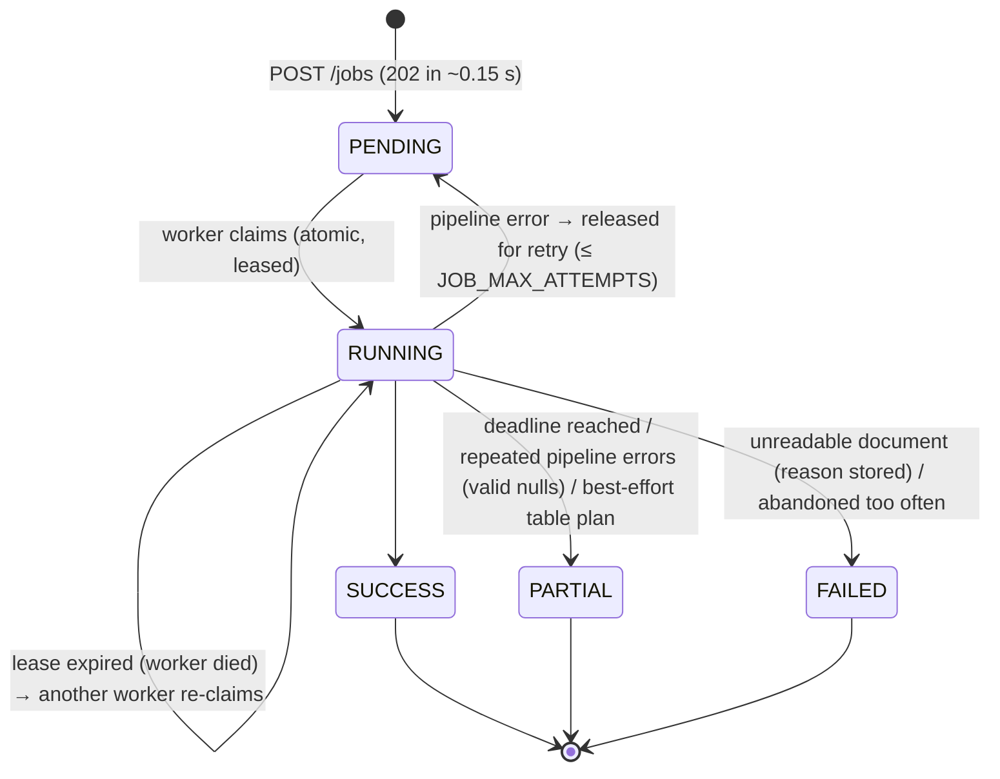
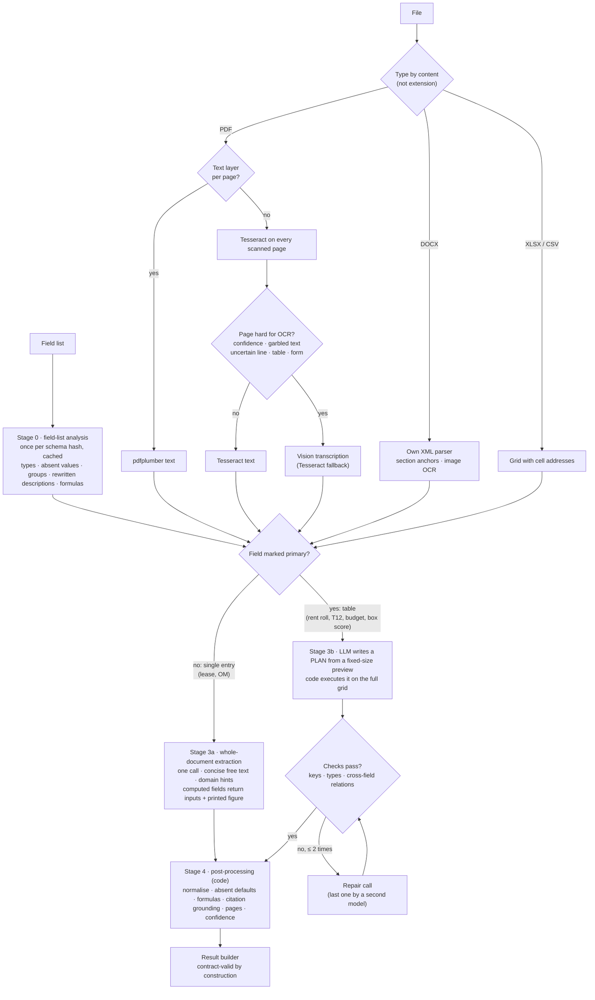

# Document Extraction Service: Design Overview (for review)

> **Purpose of this document.** A self-contained walkthrough of the service's design, every major choice, and the
> evidence behind it, written so reviewers can comment on specific decisions. Section 11 lists the questions where
> input is most useful. Compiled from `DESIGN.md`, `TECHNICAL_REPORT.md` and the working notes in `notes/`.
>
> **Status (2026-11-08):** sample-set mean **0.936** on the official validator (0.964 with an LLM judge on free-text
> fields), **0 invented values**, every output valid, **~$0.004 per document** uncached. Load test from a fresh clone at
> 10 jobs in flight: 16/16 succeeded, p50 25 s / p95 94 s, `POST` ≤ 95 ms, nothing lost or duplicated.
> Development spend **$0.84 of the $10** budget. 117 automated tests.

---

## 1. The problem in brief

A service that takes **one document** (PDF, DOCX, XLSX or CSV; digital or scanned) and **one field list** (field
keys, names, free-text descriptions; one field may be marked `primary` for tables) and returns JSON: one entry per
row (or one entry for non-tabular documents), every field as `{value, citation, confidence}` plus optional
`page_numbers` / `source_locations`.

**Hard constraints:** `docker compose up` → `/health` within 60 s; async jobs (`POST /jobs` < 2 s; terminal states
never change); ≤ 30 min per document including queue time; only 9 listed models through `LLM_BASE_URL` /
`LLM_API_KEY`; must work for **field lists never seen before**; $10 total development budget.

**Scoring (AI/ML role):** Accuracy 35 (wrong values cost more than nulls; harder fields weigh more; correct citations
earn a bonus) · Cost 15 ($/document on the graders' run) · Load/latency 15 (10 jobs in flight; p50/p95; nothing lost
or duplicated) · Design/code 35.

---

## 2. Results at a glance

### 2.1 Sample set (official `tools/validate.py`)

| Document | Input type | Strict | Judged¹ | Invented | Rows | Cost/doc² |
|---|---|---|---|---|---|---|
| boxscore_001 | CSV table | **1.000** | 1.000 | 0 | 10/10 | $0.0011 |
| budget_001 | PDF table (text layer) | **0.999** | 0.999 | 0 | 55/55 | $0.0013 |
| t12_001 | XLSX table | **0.999** | 0.999 | 0 | 119/119 | $0.0028 |
| rentroll_001 | XLSX table (3,000-row sheet) | **1.000** | 1.000 | 0 | 325/325 | $0.0018 |
| om_001 | Digital PDF, single entry (22 pp) | 0.966 | 0.966 | 0 | 1/1 | $0.0034 |
| lease_001 | Scanned PDF, 1993, handwriting (25 pp) | 0.850 | 0.875 | 0 | 1/1 | $0.0091 |
| lease_002 | DOCX (33 pp) | 0.825 | 0.900 | 0 | 1/1 | $0.0050 |
| lease_003 | Scanned PDF (21 pp) | 0.850 | 0.975 | 0 | 1/1 | $0.0089 |
| **Mean / average** | | **0.936** | **0.964** | **0** | | **$0.0042** |

¹ Judged: free-text fields re-checked by an LLM judge from another model family (the graders' scorer is "slightly
more lenient on free-text fields"). ² Uncached, i.e. what a fresh run costs; includes the field-list analysis,
which in a real run is shared by all documents with the same field list.

Scanned leases now send only the pages local OCR flags as hard to the vision model (§5.1): their cost fell from
~$0.022 to ~$0.009 per document (−44% on the sample average), with the same accuracy within noise (3-lease mean
0.873 vs 0.879 strict). The lease_001 / lease_003 changes against full vision are one yes/no judgement and two
free-text phrasings; no OCR-sensitive value changed.

All-null baseline (valid output, no extraction): **0.087**.

### 2.2 Beyond the sample set (generalisation and robustness tests)

| Test | What it probes | Score | Cost |
|---|---|---|---|
| Budget, **scanned** (every page rendered to an image) | Scanned table path | 0.991 | $0.0067 |
| Rent roll **split over two sheets** | Multi-sheet tables | 1.000 | $0.0012 |
| Rent roll **as CSV** | Format change (every cell text) | 1.000 | $0.0007 |
| Box score with the **contract's** field list (different keys) | Unseen field list | 1.000 | ~$0.001 |
| T12 / lease_002 / lease_001 with keys renamed to `field_NN` and **descriptions removed** | Worst-case unseen field list | **0.78 / 0.80 / 0.75** (was 0.54 / 0.65 / 0.63) | ~$0.002–0.005 |

With no descriptions, stage 0 first writes standard real-estate definitions from the field names (§5.0), and the
pipeline still **fails safe**: 0 invented values on every variant. The table variants were re-run on the final code.

| Robustness test | Result |
|---|---|
| 5 fresh, uncached plans per sample table | box score, budget, rent roll identical every time; T12 0.904–0.989 → **0.998–0.999** after the constants and label fixes (§5.3) |
| 15 bad or mismatched inputs (corrupt, encrypted, blank, empty, wrong type, wrong field list) | every one ends in a defined state: FAILED with the reason, 400 at upload, or valid nulls with a note; no model calls on empty input (§5.4) |
| Old vs new parsing on every sample cell (~35,000) | only intended changes (codes no longer read as numbers, percentages as displayed) |
| Confidence vs correctness | single-entry values at ≥ 0.9 right 96% of the time (82% before) (§5.4) |

### 2.3 Latency (measured on the development machine)

| Path | Typical time per document |
|---|---|
| `POST /jobs` | ≤ 95 ms under load |
| `/health` after `docker compose up` (image built) | 1.5 s |
| Table documents, under load | 16–20 s |
| Digital single-entry documents, under load | 30–68 s |
| Scanned leases, under load | 79–105 s (Tesseract on every page, vision on 2–6) |

**Load test** (Docker, real pipeline, LLM cache off; 16 jobs = 8 samples × 2 tenants, 10 in flight, topped up as jobs
finish):

| Run | Setup | p50 / p95 / max | POST max | Wall |
|---|---|---|---|---|
| 1 | 4 jobs / 8 model calls per worker, vision on every page | 129 / 203 / 227 s | 145 ms | 249 s |
| 2 | 10 / 24 | 49.5 / 82.6 / 98.7 s | 447 ms | 99 s |
| 3 | + selective vision | 104.7 / 149.7 / 183.9 s | **4,179 ms** | 184 s |
| 4 | + OCR in its own CPU pool at low priority | 29.4 / 114.7 / 130.8 s | 146 ms | 131 s |
| **5** | **all fixes, fresh clone** | **25.2 / 94.4 / 105.3 s** | **95 ms** | **107 s** |

Every run: 16/16 SUCCESS, all valid, 0 lost / duplicated, tenant isolation ✓. Run 1 was queueing (20 s table jobs
behind scanned leases). Run 3 was a regression: per-page Tesseract filled the worker's thread pool, so claims,
heartbeats and spreadsheet reads waited behind OCR (tables 103 s) and the API slowed; OCR now has its own pool.

---

## 3. System architecture

**Job lifecycle**

**Service guarantees and how they are enforced**

| Guarantee | Mechanism | Tested |
|---|---|---|
| A job is processed by exactly one worker | SQLite `BEGIN IMMEDIATE` claim; the job table is the queue | 8 threads × 40 jobs, each claimed once |
| A crashed worker loses no job | Leases + heartbeats; expired RUNNING jobs re-claimed; caches make the re-run nearly free | Crash simulation |
| A stale worker cannot overwrite | Fencing: every update requires the current lease owner | ✓ |
| Terminal states never change | Every update requires `status = RUNNING` | ✓ |
| Same document + field list twice ≠ work twice | Idempotency key = sha256(file) + canonical schema, per tenant | ✓ |
| Tenant isolation | `X-Organization-Id` scoping; other tenants get 404 | ✓ |
| Throttling does not fail jobs | Retries with exponential backoff + jitter, honouring Retry-After; per-attempt total time cap; deadline-aware | ✓ |
| A bug never loses a document | Pipeline errors retried, then PARTIAL with valid nulls; FAILED only for unreadable documents | ✓ |
| Diagnosable failures | JSON logs with job_id, stage, timings, cost; error code + message on the job | — |

Scaling: raise `WORKER_CONCURRENCY` or `docker compose up --scale worker=N`; all workers share one queue.

---

## 4. The extraction pipeline

**One principle runs through it:** the LLM is used for *understanding* (what a field means, where a value is, how a
table is laid out); **code does everything mechanical** (reading cells, arithmetic, formatting, citations, page
numbers). This keeps cost flat, values traceable, and invented values near zero.

---

## 5. Stage-by-stage design, with evidence

Every option below was measured before it was chosen, using the rule **"cheapest option within noise of the best"**
(noise measured at ±0.02–0.03 on a 3-document mean). Free (LLM-less) measurements came first; paid tests were
targeted at the questions that mattered.

### 5.0 Stage 0: field-list analysis

- **What:** heuristics (free) + one cheap LLM call per *new* field list, cached by schema hash and shared by concurrent
  jobs. Produces per field: type, value when absent (null / 0 / false / []), row vs document scope, group, a rewritten
  unambiguous description, and for computed fields a **formula** in a small safe expression language
  (`months_between`, `sum`, `mul`, `div`, `round`, …; parsed with a whitelist, never `eval`).
- **Why:** unseen field lists must work; and in E1b most remaining errors were interpretation errors that every model
  shared, which clearer descriptions fix and bigger models do not.
- **Terse field lists (one extra call, only when needed):** a field is terse if its description is empty, repeats its
  name or has ≤ 3 words; when ≥ 25% of a list is terse, stage 0 first writes standard real-estate definitions for
  those fields (inferring the document type from all names together). None of the 6 sample lists triggers it.

  | Terse + renamed variant | Before | Definitions v1 | **v2 (adopted)** | Full descriptions |
  |---|---|---|---|---|
  | lease_002 | 0.650 (0 invented) | 0.550 (9 invented) | **0.800 (0)** | 0.825 |
  | lease_001 | 0.625 (0) | 0.610 (6) | **0.750 (0)** | 0.850 |
  | T12 | 0.542 (140/119 rows) | 0.542 | **0.781 (119/119)** | 0.999 |

  v1 invented absence conventions ("0 if absent"), which became wrong defaults; v2 says "null if the document does
  not state it", with two exceptions (yes/no → false, lists → empty).
- **Fallback:** if the call fails, heuristic types and the original descriptions are used.

### 5.1 Ingestion (stage 1)

**E0: free comparison of every reader/OCR option** (share of non-computed answer values present in the extracted text):

| Input | Option | Result | Chosen |
|---|---|---|---|
| Digital PDF | pdftotext, pdftotext `-layout`, pdfplumber, PyMuPDF, pymupdf4llm | All capture 99–100%; layout mode costs 2–3.5× tokens for nothing; pdfplumber best on the budget table | **pdfplumber** |
| Scanned PDF | Tesseract (200/300 dpi, psm 3/6), RapidOCR | RapidOCR 85–89% verbatim vs Tesseract 80–85%, but ~3× CPU; **neither reads handwriting** | Tesseract for easy pages, vision for hard ones (below) |
| DOCX | python-docx, mammoth, own XML parser | Same text; only the own parser yields usable sections (49, median ~240 tokens) and image transcriptions | **Own parser** |

**E1a: vision transcription of the pages local OCR got wrong** ($0.014):

| Model | Handwritten deposit (`~~2,400~~ [handwritten: 2150]`) | Garbled name | Table control | $/page |
|---|---|---|---|---|
| Local OCR (both engines) | ✗ | ✗ | ✓ | 0 |
| gpt-6-luna | ✓ | ✓ | ✓ | 0.0006 (reasoning off) |
| claude-haiku-5.5 | ✓ | ✓ | ✓ | 0.0006–0.0011 |
| glm-5.3-flash | ✓ | ✓ | ✓ | ~0.0005 |
| qwen3-vl | ✗ ambiguous | ✓ | ✓ | 0.0007–0.0020 |

→ **Hard scanned pages: gpt-6-luna vision (reasoning off), Tesseract as per-page fallback.**

**Selective vision: which pages go to the vision model.** Tesseract reads every scanned page first (free). Labels
came from the cached vision transcriptions: did OCR lose an answer value that vision caught? (Vision marks
"handwriting" on nearly every page of the 1993 lease because of initials, so handwriting alone is not useful.) Three
pages qualify: lease_001 p2 (handwritten deposit), p25 (garbled guarantor), lease_003 p3 (rent table). A page goes to
vision if **any** signal fires:

| Signal | Threshold | Catches on the samples |
|---|---|---|
| Mean Tesseract word confidence | < 0.88 | lease_001 p2, p25 and others |
| Words below confidence 50 | ≥ 5% | (overlaps confidence) |
| Lines with 3+ numbers (tables, rent schedules) | ≥ 15% | lease_003 p3 |
| "LABEL:" lines (summary / reference pages) | ≥ 10% | form pages |
| Garbled text: broken tokens ("MART/N") / unusual characters | ≥ 5% / ≥ 2% | only a page already flagged; safety net |
| One uncertain line: 2+ words below 60, a digit, a real word, not a stamp/footer recurring on other pages | 1 line | alone, both lease_001 needed pages; no extra pages |

Flags all 3 needed pages and 6/25 + 2/21 pages overall. The footer filter is fuzzy (letters only, similarity ≥ 0.75 on
2+ other pages) because Tesseract reads the same stamp differently on each page ("1D#3 03122", "ID#3 03118"); exact
matching let 3 stamp pages through. Rejected: any low-confidence word next to a digit (19/25 pages); any line with 2
low words (16/25); a dictionary check (no word list in the image). Table documents keep vision on every page (their
plan needs a consistent layout).

**Vision image size:** 1,100 px instead of 1,500 px cuts vision input ~45%, but lost the landlord's legal name on
the hardest page; with selective vision the saving would be ~$0.001 per document → **1,500 px for all documents**.

**DOCX findings that shaped the parser:** no Word heading styles at all (headings detected by rule, including
run-in headings like "17. HOLDING OVER. Tenant shall…"); the table of contents repeats every heading (TOC mode);
auto-numbering reconstructed from `numbering.xml`; embedded images include a scanned signature page with a
handwritten date (transcribed); images stored twice by Word deduplicated.

**Coordinates:** every document becomes Markdown with anchors: `[Page N]` (PDF), `[Section NNN: …]` (DOCX),
`[Table ID: …]`, `[Image ID: …]`. Citations and `page_numbers` come from these.

### 5.2 Single-entry documents (stage 3a)

**Whole document, one call.** In E1b cheap models scored the same on full documents as on hand-picked relevant
passages, so a Locator stage did not pay for itself at these sizes (≤ ~26k tokens); it is reserved for very long
documents (not built yet).

**E1b: model screen** (original descriptions; later superseded):

| Model | Score, full documents | $/doc |
|---|---|---|
| glm-5.3-flash | 0.853 | 0.0038 (list) |
| claude-haiku-5.5 | 0.835 | 0.0048 |
| deepseek-v3.2 | 0.794 | 0.0051 (and ~45 s/doc) |
| gpt-6-luna, reasoning off | 0.743 | 0.0025 |

Also learned: **cross-model disagreement flags ~24% of fields and catches >90% of the errors** (a free escalation
signal); hidden reasoning tokens are pure cost for extraction; a gemini-flash second round fixed half the errors but
not the shared interpretation ones.

**E2: closing the gap with the prompt, not the model** (4 documents; judged = free-text fields judged):

| Change | Strict | Judged |
|---|---|---|
| Free text as described (baseline) | 0.845 | 0.889 |
| Free text verbatim (quote) | 0.835 | 0.928 |
| **Free text concise** (example's format, document's words, every fact kept) | 0.858 | 0.914 |
| **+ generic domain hints v3** (identifier only; property name ≠ owner's company; rights only for the named party; "none" for no-change terms) | **0.879** | **0.935** |

Hint iterations: v1 turned an address-like building name into "None"; v2's free-rent rule leaked into the rent
schedule; v3 removed it. Tuning stopped there to avoid fitting three leases.

**Model choice with the final prompt:** gpt-6-luna 0.879 / 0.935 · glm 0.873 / 0.935 · haiku 0.873 / 0.923 →
**keep luna** (cheapest; the E1b gap was closed by the prompt). glm rejects `reasoning: off` (the fallback model
answered every call; the job still succeeded).

**Computed fields (E2a), from one response:**

| Mode | Mean | Notes |
|---|---|---|
| M: the model's own arithmetic | 0.833 | Wrong on 4 lease cells (sums over periods, rounding, net vs gross of free rent) |
| C: code evaluates the stage-0 formula | 0.845 | All 4 right |
| **H: printed figure if the document prints one, else the formula** (agreement raises confidence) | **0.845** | Chosen |

**Pointer mode (the "LLM points, code fills" idea applied to prose):** every value backed by an exact quote that code
locates in the document, sets the page from, and verifies the value against.

| Approach | Strict | Judged | Correct pages / given | $/doc |
|---|---|---|---|---|
| **value (default)** | 0.879 | 0.935 | 78 / 84 | ~0.0035 |
| pointer (quotes for "as stated" free text) | 0.879 | 0.935 | 81 / 91 | ~0.0039 |
| hybrid (pointers for typed values, concise free text) | 0.860 | 0.935 | 81 / 91 | ~0.0039 |

Tied on accuracy → value stays the default for documents; **hybrid is used automatically for single-entry field lists
over spreadsheets**, where values are read from the exact cells.

### 5.3 Table documents (stage 3b): the plan executor

**Plan format** (LLM-written JSON, executed by code on the full grid): records by rule (`record_start` pattern,
`require_values`, `skip_if`, `stop_at`, `record_end`), columns (incl. part of a cell via a capture group),
multi-row blocks (`first` / `join` / `sum` / `value` / `count` with `where` conditions), section headers (nearest
header row above), row aggregates, constants with their cell, `classify` (one label per *distinct* input, e.g.
Revenue/Expense/Other per section), value maps, null values, blank defaults, `missing`, **required cross-field
`checks`**, and several sheets.

**Why:** cost is flat (~$0.001–0.003 per table regardless of length: the rent roll has 3,000 rows); values are copied
from cells, so they cannot be invented; every value carries its cell address or page.

**Safeguards, each added after a measured failure:**

| Safeguard | Failure that motivated it |
|---|---|
| A per-row field whose description mentions a column cannot be "missing" | T12 plan dropped the first/last month columns |
| Free text that continues onto following lines must be joined | Budget plan read only the first line of each explanation |
| `value` mode matching several different lines is flagged | Rent roll units with two "Rent" lines |
| **Required cross-field checks** from the descriptions ("should equal rent plus other charges"), verified on every row | A plan read the rent roll total from the wrong line; optional checks were ignored by the model |
| Up to two repair rounds, the last by a second model (claude-haiku-5.5) | luna's repairs could not fix the CSV rent roll; haiku's did (0.946 → 1.000) |
| LLM-writes-rows fallback only for tables ≤ 400 rows; else best plan + PARTIAL | A failed plan on a 3,000-row sheet triggered 31 fallback calls |
| Duplicate primary keys merged | The rent roll lists 5 units twice (main list + future residents) |

Tried and **not** adopted: other plan models (glm, haiku each failed a different table); majority vote over three
plans (fixed one table, broke another).

**Every table input format:**

| Format | How the grid is built | Evidence |
|---|---|---|
| XLSX / CSV | Cells with addresses; merged cells filled | Samples 0.999–1.000 |
| Several sheets | Same plan applied per sheet; per-sheet constants | Two-sheet rent roll 1.000 |
| PDF with text layer | Word positions → lines → fragments → column gutters; repeated page headers removed; rows keep their page | Budget 0.999 |
| Scanned PDF | Vision transcription with a table prompt; **page 1's column header imposed on the other pages** | Scanned budget 0.701 → 0.930 → **0.991** |
| DOCX | Word tables + paragraphs as rows (struck-through text dropped) | Unit-tested |
| Digital PDF without table-like lines | The text lines become the grid (never vision on pages with text) | Unit-tested |

**Fresh-plan variance** (5 uncached plans per sample table): box score, budget and rent roll scored the same every
time; T12 scored 0.904–0.989 because plans typed the header value themselves and shortened "Property =  417 .417" to
"417" in 4 of 5 runs, and the label step varied with its inputs. Document-wide constants are now read as printed in
the cell they cite (text fields only: a typed value such as budget year 2021 in "File: 2021.cm3" stays typed), and
labels always see the row's own name and code: T12 over the same 5 plans **0.923 → 0.998–0.999**. Rejected: labels in
document order (consistently worse), a 3-vote majority (no better, 4× the cost).

### 5.4 Post-processing (stage 4)

Type normalisation (one figure per value: currency, thousands separators, negatives in parentheses, units and
multipliers such as "$24.50/SF" or "$1.2 million"; a string with several figures such as "1,200-1,500" is null, never
the digits run together; labels such as "C5" are not amounts; percentages as printed; dates in many formats including
filled-in "19 93" forms); absent values ("0 if none" etc.) only after a real extraction; computed fields (mode H);
citation grounding (verbatim check against the document); `page_numbers` from anchors or by locating the value. A
citation that cannot be found **lowers confidence but never nulls a value**: E1b showed it is a weak error signal.

**Absent, bad and failed inputs** (15 cases tested with stubbed model calls): unstated values → null; unreadable files
(corrupt, encrypted) → FAILED with the reason; unsupported files → 400 at upload; blank or empty documents, and table
field lists on documents without a table → valid nulls (PARTIAL, with a note) and no model call; failed model calls →
the next attempt or the fallback model, then valid nulls. Before the fix, a job whose every extraction call failed
still emitted 8 values from absence defaults ("false", 0).

**Confidence is evidence-based** and was checked against the answers: free text 0.7 cited / 0.55 not (paraphrase);
yes/no 0.8 / 0.65 (a judgement); computed 0.85 ± agreement of printed figure, formula and model; printed values 0.92
when both the citation and the value are found in the document, 0.75 one of them, 0.5 neither; nulls 0.75.

| | Brier (lower is better) | Calibration error | Values at ≥ 0.9: right |
|---|---|---|---|
| Single-entry, before | 0.152 | 0.164 | 82% |
| **Single-entry, after** | **0.108** | **0.078** | **96%** |
| Tables, before → after | 0.022 → 0.012 | 0.115 → 0.095 | 100% |

---

## 6. LLM layer and cost control

- **One chokepoint** for every model call: allowed-model check → content-addressed **response cache** (SQLite; key =
  model + messages + parameters, images hashed) → identical concurrent requests share one call → budget guard →
  retries → **spend ledger** (append-only JSONL, committed).
- **Cache modes:** read_write (development), **replay** (fails loudly instead of spending: guarantees $0 re-scoring
  and catches accidental prompt changes), refresh, off. Production keeps the cache on, so a restarted job never pays twice.
- **Development discipline:** dry-run cost estimates (including hidden reasoning tokens) and a per-run cap before
  every paid run; free measurements first; every downstream change re-scored at $0.

**Models used**

| Stage | Model | Cost |
|---|---|---|
| Field-list analysis | gpt-6-luna, reasoning off | ~$0.001 per new field list |
| Scanned-page transcription (hard pages only) | gpt-6-luna, reasoning off | ~$0.0006–0.0007 per page |
| Lease / OM extraction | gpt-6-luna, reasoning off (fallback claude-haiku-5.5) | ~$0.003–0.005 per document |
| Table plans | gpt-6-luna, reasoning off; last repair by claude-haiku-5.5 | ~$0.001–0.003 per document |
| Free-text judge (evaluation only) | claude-haiku-5.5 | — |

**Where a scanned lease's ~$0.009 goes** (ledger medians: ~$0.0007 per vision page, ~$0.0007 per field-list
analysis): vision 15–50% (2 pages on lease_003, 6 on lease_001), field-list analysis ~8% (shared across documents
with the same list), extraction the rest. With every page by vision it was ~$0.022, ~75% of it vision.

---

## 7. Evaluation method

- **Official validator** for every score; per-field outcome classes (correct / miss / wrong / invented).
- **LLM judge for free text**, from a different model family than the extractor, applied **only to free-text
  fields** (it is too lenient on short identifiers, e.g. it accepted "Second Floor, West Section, Suite 214W" for
  "Suite 214W").
- **Noise:** repeated runs at temperature 0 change 0–4 values per document (±0.02–0.03 on a mean), so differences
  smaller than that are treated as ties.
- **Generalisation set (E5)** built from the samples: unseen field lists, renamed keys, removed descriptions, format
  conversions, a scanned copy, a multi-sheet split.
- **Reproducibility:** `outputs/` is regenerated from cached responses in replay mode; a replay that would need a new
  call fails instead of spending.

---

## 8. Decision log (summary)

| Area | Decision | Main alternatives | Evidence |
|---|---|---|---|
| Language / stack | Python, FastAPI, SQLite | — | Best document tooling; validator is Python |
| Digital PDF text | pdfplumber | 4 other readers | E0 |
| Scanned pages | Tesseract first; vision (luna, reasoning off) only on pages flagged hard | Local OCR only; vision on every page; other vision models | E1a: only vision reads handwriting; selective = same accuracy, −60% scanned cost |
| Vision image size | 1,500 px long side | 1,100 px; 1,100 px for single-entry only | Lost a legal name at 1,100 px; ~$0.001/doc saving |
| DOCX | Own XML parser with heuristic and run-in headings | python-docx, mammoth | E0 sections, image transcription |
| DOCX pages | Not produced (section anchors instead) | LibreOffice rendering | Image size and start-up risk |
| Terse field lists | Stage 0 writes standard definitions when ≥ 25% are terse | Leave as is | E5: +0.15–0.24, 0 invented |
| Single-entry strategy | Whole document, one call | Locator + slices; per-group calls | E1b: no long-context penalty |
| Extractor model | gpt-6-luna, reasoning off | glm, haiku, deepseek | E2: tied with the final prompt, cheapest |
| Free-text style | Concise (switchable to verbatim) | Describe, verbatim | E2: best strict, near-best judged |
| Domain hints | Generic v3 | None, v1, v2 | E2 hints table |
| Computed fields | Hybrid H (printed figure, else formula) | Model arithmetic, formula only | E2a |
| Single-entry extraction style | Value (hybrid for spreadsheets) | Pointer, hybrid | Pointer comparison |
| Tables | LLM plan, code executes | LLM writes rows; LLM writes code | Cost flat, no invented values |
| Table safety | Required checks + 2 repairs (last by haiku) + bounded fallback | Plan voting; other plan models | §5.3 |
| Job store / queue | SQLite table as queue, leases | Redis, Postgres | No extra container; tested guarantees |
| Concurrency defaults | 10 jobs per worker, 24 concurrent model calls; OCR in its own CPU pool at nice 10 | 4 / 8; shared pool | Load tests: p50 129 → 25 s, POST ≤ 95 ms |
| Table constants and labels | Printed value from the cited cell (text); labels on the row's own fields | Plan's typed value; 3-vote labels | Fresh-plan variance: T12 0.923 → 0.998 |
| Bad and empty inputs | FAILED only for unreadable files; valid nulls otherwise, no calls on empty input | Retry; FAILED | Failure matrix (15 cases) |
| Confidence | Evidence-based (type, citation found, value found, agreement) | Flat by grounding | Calibration: ≥ 0.9 bin 82% → 96% right |
| Escalation (2nd model) | Not yet | Disagreement → stronger model | Remaining errors are phrasing/interpretation |

---

## 9. What broke along the way (and what changed because of it)

- A run took **80 minutes**: calls hung for a 300 s read timeout before retrying → total time cap per attempt
  (httpx's timeout only bounds gaps between bytes) and deadline-aware retries.
- **Hidden reasoning tokens** made a test cost 3.5× its estimate → estimates include them; reasoning off by default.
- `docker compose` defaulted to the placeholder null pipeline → fixed before any deployment.
- Committed outputs could not be reproduced after a prompt change → replay mode now proves reproducibility.
- Scanned table pages transcribed independently chose **different column layouts** → page 1's header imposed on the rest.
- A failed table plan triggered a **31-call fallback** on a big sheet → bounded fallback, second-model repair.
- The first load test queued 20 s table jobs behind scanned leases for ~200 s → higher worker and model-call
  concurrency (`docker-compose.yml` also had to pass the setting through).
- Standard definitions for terse field lists first **invented "0 if absent" conventions** (9 invented values) →
  "null if not stated" rule; and the OM's single "City." description triggered expansion → only when ≥ 25% are terse.
- Footer stamps defeated an exact-match boilerplate filter (OCR reads them differently on each page) → fuzzy match.
- Selective vision moved scanned pages onto the CPU and **per-page OCR starved the worker** (POST 4.2 s, tables 103 s)
  → OCR in its own pool at low priority. The fresh Docker build also filled the disk (old image left dangling).
- Selective vision also **broke scanned tables** (plain OCR text has no table structure: 1 of 55 rows), caught by a
  replay of the scanned-budget variant → table documents always use vision on every page.
- Our own fixes regressed twice, both caught at $0: a number-parser change read labels as amounts ("C5" → 5; an
  old-vs-new comparison on every sample cell), and the constants change broke a typed field (scanned budget 0.919).

---

## 10. Known gaps

| Gap | Impact | Idea |
|---|---|---|
| A hard scanned page that every OCR signal misses is read by Tesseract alone | A value lost on such a page | Send a page to vision when the extraction cites it for a null or low-confidence field |
| Confidence is measured but not acted on | Uncertain values are not re-checked | Second cheap model below ~0.8, escalate disagreements |
| Field lists of ~75+ fields | One extraction call's output cap would truncate them | Extract by stage-0 group in parallel |
| Scanned PDFs with a scanner's hidden OCR layer; mixed scanned/digital table PDFs | Our OCR and vision rule bypassed; rows on scanned pages lost | Detect invisible text; per-page routing for tables |
| Several worker containers not load-tested | Scaling claim rests on design and unit tests | Load test with `--scale worker=2` |
| Terse field lists still lose 0.03–0.2 against full descriptions | Unseen field lists | Accept (no invented values) |
| Interpretation conventions (rent start after free rent; subject property's in-place rent; property name from the cover) | ~3–4 sample cells | Field-scoped hints written by stage 0 (risk of fitting the samples) |
| Very long documents (100+ pages) | Untested | Locator path (designed, not built) |
| Docker image 1.46 GB, 188 s build | Start-up gate if build time counts | Slim the image |
| DOCX `page_numbers` | Citation bonus on DOCX | Would need rendering |

---

## 11. Questions for reviewers

1. **Free-text style:** concise (best under strict matching) or verbatim (best under an LLM judge)? We don't know
   exactly how the graders judge free text.
2. **Selective vision for scanned pages:** the rule (§5.1) was tuned on 3 pages that needed vision across 2 leases.
   Would you trust it on unseen scans, or pay ~$0.013 more per scanned lease for vision on every page?
3. **Interpretation hints:** worth adding field-scoped real-estate conventions, or too much risk of fitting the samples?
4. **Escalation:** is a second-model check per document worth ~+$0.004/doc for the remaining error types?
5. **Latency vs cost:** prefer parallel field-group calls (faster, slightly dearer) or one call per document?
6. **Anything in the service guarantees (§3) you would test differently?**

---

## 12. Planned next steps (ranked)

Done since the first version of this document: load test and concurrency tuning; selective vision (with garbage-text
and uncertain-line signals); vision resolution test; standard definitions for terse field lists; a code review of the
data path (number, date, percent, DOCX and table handling); fresh-plan variance fixes; defined states for bad and
empty inputs; evidence-based confidence; a final load test from a fresh clone.

1. Act on confidence: a second cheap model on fields below ~0.8, escalating disagreements.
2. Field-scoped interpretation hints (question 3), only if they generalise beyond the samples.
3. Large field lists by group; hidden OCR text layers; a multi-container load test.
4. Docker polish: commit SHA in `/health`, slimmer image.

---

## Appendix A: development spend

| Phase | Calls | $ |
|---|---|---|
| Live check | 1 | 0.000004 |
| E0 ingestion comparison | 0 | 0 |
| E1a vision transcription | 18 | 0.0142 |
| E1b model screen (round 1, judge, noise, round 2a) | 52 | 0.1719 |
| Pipeline v1, single-entry runs | 73 | 0.0622 |
| Pipeline v1, tables (+ reproducibility re-run) | 14 | 0.0102 |
| E2 free text, hints, model choice, E5 generalisation | 53 | 0.1082 |
| Improvement rounds (table checks, pointer modes, scanned tables, multi-sheet) | 119 | 0.1239 |
| Docker end-to-end check (recorded in the container's own ledger) | 2 | 0.0013 |
| Load tests in Docker, cache off (before / after tuning; container ledgers) | 206 | 0.1587 |
| Selective vision, resolution test, judge | 8 | 0.0121 |
| Standard definitions for terse field lists (v1, v2) | 16 | 0.0268 |
| Load tests in Docker with selective vision (3 runs; container ledgers) | 107 | 0.1134 |
| Table variants re-run on final code | 4 | 0.0022 |
| Fresh-plan variance (20 plans) and label-step variants | 92 | 0.0327 |
| **Total** | **765** | **0.8379** |

Computed from `ledger/spend.jsonl` by run id (every call maps to a phase), plus the Docker containers' own ledgers.
The garbage-text and uncertain-line signals, the code review, the failure matrix and the calibration cost $0 (local
OCR, stubbed calls and cached replays).

## Appendix B: configuration reference

| Setting | Default | Meaning |
|---|---|---|
| `LLM_BASE_URL`, `LLM_API_KEY` | — | Gateway and key (required) |
| `PIPELINE` | `v1` | `null` = placeholder (tests) |
| `EXTRACT_MODEL` / `VISION_MODEL` / `TABLE_MODEL` / `ANALYSIS_MODEL` | gpt-6-luna | Per-stage models |
| `*_EXTRA` | `{"reasoning": {"enabled": false}}` | Per-stage request parameters |
| `FALLBACK_MODEL` | claude-haiku-5.5 | Unusable output fallback; last table-plan repair |
| `FREETEXT_MODE` | `concise` | `concise` / `verbatim` / `describe` |
| `HINTS` | `on` | Generic domain rules |
| `EXTRACT_STYLE` | `value` | `value` / `pointer` / `hybrid` |
| `COMPUTED_MODE` | `H` | `M` / `C` / `H` |
| `SCANNED_MODE` | `selective` | `selective` (OCR first, vision for hard pages) / `vision` (every page) / `ocr` |
| `VISION_LONG_SIDE` | 1500 | Long side of images sent to the vision model (px) |
| `WORKER_CONCURRENCY` | 10 | Jobs per worker process |
| `LLM_MAX_CONCURRENCY` | 24 | Concurrent model calls per process |
| `OCR_WORKERS` | CPUs − 2 | Page rendering / OCR pool (runs at low priority) |
| `LLM_TIMEOUT_S` | 90 | Default total time per call attempt |
| `JOB_DEADLINE_S` | 1200 | Internal deadline from submission |
| `LLM_CACHE_MODE` | `read_write` | `off` / `read_write` / `replay` / `refresh` |

## Appendix C: repository map

| Path | What |
|---|---|
| `app/service/` | API, job store/queue, workers, logging, settings |
| `app/pipeline/` | Stage 0 analysis, ingestion orchestration, single-entry extractor, table planner/executor, post-processing, formula language |
| `app/ingest/` | PDF / DOCX / OCR / grid readers, anchored document model |
| `app/llm/` | Model chokepoint: cache, ledger, pricing, retries, usage |
| `app/eval/` | Experiments: E0, E1a, E1b, judge, run_samples, generalisation, load test |
| `notes/` | Working notes per step (ideation → revision → results) |
| `experiments/` | Scores and verdicts (no document content) |
| `tests/` | 117 tests |
