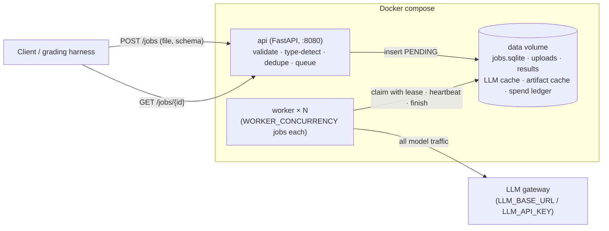
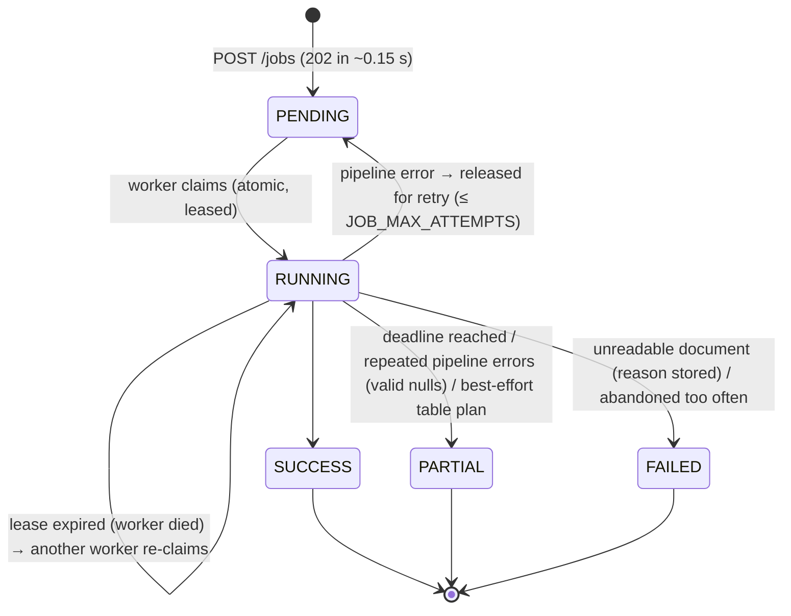
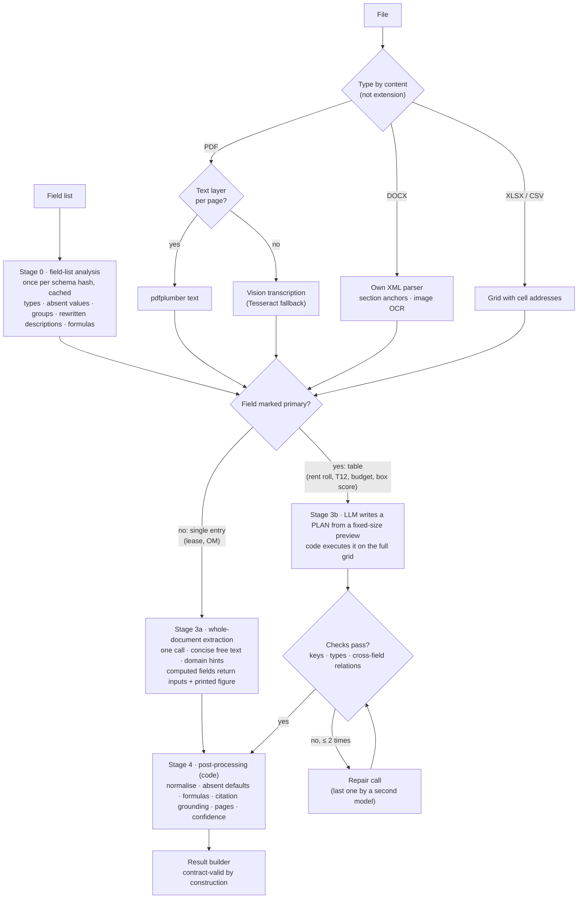

# Document Extraction Service: Design Overview (for review)

> **Purpose of this document.** A self-contained walkthrough of the service's design, every major choice, and the
> evidence behind it, written so reviewers can comment on specific decisions. Section 11 lists the questions where
> input is most useful. Compiled from `DESIGN.md`, `TECHNICAL_REPORT.md` and the working notes in `notes/`.
>
> **Status (2026-11-07):** sample-set mean **0.939** on the official validator (0.967 with an LLM judge on free-text
> fields), **0 invented values**, every output valid, `docker compose up` verified end to end. Development spend
> **$0.49 of the $10** budget. 101 automated tests.

---

## 1. The problem in brief

A service that takes **one document** (PDF, DOCX, XLSX or CSV; digital or scanned) and **one field list** (field
keys, names, free-text descriptions; one field may be marked `primary` for tables) and returns JSON: one entry per
row (or one entry for non-tabular documents), every field as `{value, citation, confidence}` plus optional
`page_numbers` / `source_locations`.

**Hard constraints:** `docker compose up` → `/health` within 60 s; async jobs (`POST /jobs` < 2 s; terminal states
never change); ≤ 30 min per document including queue time; only 9 listed models through `LLM_BASE_URL` /
`LLM_API_KEY`; must work for **field lists never seen before**; $10 total development budget.

**Scoring (AI/ML role):** Accuracy 35 (wrong values cost more than nulls; harder fields weigh more; correct citations
earn a bonus) · Cost 15 ($/document on the graders' run) · Load/latency 15 (10 jobs in flight; p50/p95; nothing lost
or duplicated) · Design/code 35.

---

## 2. Results at a glance

### 2.1 Sample set (official `tools/validate.py`)

| Document | Input type | Strict | Judged¹ | Invented | Rows | Cost/doc² |
|---|---|---|---|---|---|---|
| boxscore_001 | CSV table | **1.000** | 1.000 | 0 | 10/10 | $0.0011 |
| budget_001 | PDF table (text layer) | **0.999** | 0.999 | 0 | 55/55 | $0.0013 |
| t12_001 | XLSX table | **0.999** | 0.999 | 0 | 119/119 | $0.0028 |
| rentroll_001 | XLSX table (3,000-row sheet) | **1.000** | 1.000 | 0 | 325/325 | $0.0018 |
| om_001 | Digital PDF, single entry (22 pp) | 0.966 | 0.966 | 0 | 1/1 | $0.0034 |
| lease_001 | Scanned PDF, 1993, handwriting (25 pp) | 0.900 | 0.925 | 0 | 1/1 | $0.0218 |
| lease_002 | DOCX (33 pp) | 0.825 | 0.875 | 0 | 1/1 | $0.0050 |
| lease_003 | Scanned PDF (21 pp) | 0.825 | 0.975 | 0 | 1/1 | $0.0225 |
| **Mean / average** | | **0.939** | **0.967** | **0** | | **$0.0075** |

¹ Judged: free-text fields re-checked by an LLM judge from another model family (the graders' scorer is "slightly
more lenient on free-text fields"). ² Uncached, i.e. what a fresh run costs; includes the field-list analysis,
which in a real run is shared by all documents with the same field list.

All-null baseline (valid output, no extraction): **0.087**.

### 2.2 Beyond the sample set (generalisation and robustness tests)

| Test | What it probes | Score | Cost |
|---|---|---|---|
| Budget, **scanned** (every page rendered to an image) | Scanned table path | 0.991 | $0.0067 |
| Rent roll **split over two sheets** | Multi-sheet tables | 1.000 | $0.0012 |
| Rent roll **as CSV** | Format change | 1.000 | $0.0015 |
| Box score with the **contract's** field list (different keys) | Unseen field list | 1.000 | ~$0.001 |
| T12 / lease_002 / lease_001 with keys renamed to `field_NN` and **descriptions removed** | Worst-case unseen field list | 0.54 / 0.65 / 0.63 | ~$0.001–0.004 |

With no descriptions at all the pipeline **fails safe**: it returns nulls, never invented values.

### 2.3 Latency (measured on the development machine)

| Path | Typical time per document |
|---|---|
| `POST /jobs` | 134–240 ms |
| `/health` after `docker compose up` (image built) | ~2 s |
| Table documents | ~5–15 s (box score in Docker: 17 s end to end) |
| Digital single-entry documents | ~20–40 s |
| Scanned leases (25 vision pages) | ~45–60 s |

Not yet measured: behaviour at 10 jobs in flight (load test pending).

---

## 3. System architecture

**Job lifecycle**

**Service guarantees and how they are enforced**

| Guarantee | Mechanism | Tested |
|---|---|---|
| A job is processed by exactly one worker | SQLite `BEGIN IMMEDIATE` claim; the job table is the queue | 8 threads × 40 jobs, each claimed once |
| A crashed worker loses no job | Leases + heartbeats; expired RUNNING jobs re-claimed; caches make the re-run nearly free | Crash simulation |
| A stale worker cannot overwrite | Fencing: every update requires the current lease owner | ✓ |
| Terminal states never change | Every update requires `status = RUNNING` | ✓ |
| Same document + field list twice ≠ work twice | Idempotency key = sha256(file) + canonical schema, per tenant | ✓ |
| Tenant isolation | `X-Organization-Id` scoping; other tenants get 404 | ✓ |
| Throttling does not fail jobs | Retries with exponential backoff + jitter, honouring Retry-After; per-attempt total time cap; deadline-aware | ✓ |
| A bug never loses a document | Pipeline errors retried, then PARTIAL with valid nulls; FAILED only for unreadable documents | ✓ |
| Diagnosable failures | JSON logs with job_id, stage, timings, cost; error code + message on the job | — |

Scaling: raise `WORKER_CONCURRENCY` or `docker compose up --scale worker=N`; all workers share one queue.

---

## 4. The extraction pipeline

**One principle runs through it:** the LLM is used for *understanding* (what a field means, where a value is, how a
table is laid out); **code does everything mechanical** (reading cells, arithmetic, formatting, citations, page
numbers). This keeps cost flat, values traceable, and invented values near zero.

---

## 5. Stage-by-stage design, with evidence

Every option below was measured before it was chosen, using the rule **"cheapest option within noise of the best"**
(noise measured at ±0.02–0.03 on a 3-document mean). Free (LLM-less) measurements came first; paid tests were
targeted at the questions that mattered.

### 5.0 Stage 0: field-list analysis

- **What:** heuristics (free) + one cheap LLM call per *new* field list, cached by schema hash and shared by concurrent
  jobs. Produces per field: type, value when absent (null / 0 / false / []), row vs document scope, group, a rewritten
  unambiguous description, and for computed fields a **formula** in a small safe expression language
  (`months_between`, `sum`, `mul`, `div`, `round`, …; parsed with a whitelist, never `eval`).
- **Why:** unseen field lists must work; and in E1b most remaining errors were interpretation errors that every model
  shared, which clearer descriptions fix and bigger models do not.
- **Fallback:** if the call fails, heuristic types and the original descriptions are used.

### 5.1 Ingestion (stage 1)

**E0: free comparison of every reader/OCR option** (share of non-computed answer values present in the extracted text):

| Input | Option | Result | Chosen |
|---|---|---|---|
| Digital PDF | pdftotext, pdftotext `-layout`, pdfplumber, PyMuPDF, pymupdf4llm | All capture 99–100%; layout mode costs 2–3.5× tokens for nothing; pdfplumber best on the budget table | **pdfplumber** |
| Scanned PDF | Tesseract (200/300 dpi, psm 3/6), RapidOCR | RapidOCR 85–89% verbatim vs Tesseract 80–85%, but ~3× CPU; **neither reads handwriting** | Vision (below); Tesseract fallback |
| DOCX | python-docx, mammoth, own XML parser | Same text; only the own parser yields usable sections (49, median ~240 tokens) and image transcriptions | **Own parser** |

**E1a: vision transcription of the pages local OCR got wrong** ($0.014):

| Model | Handwritten deposit (`~~2,400~~ [handwritten: 2150]`) | Garbled name | Table control | $/page |
|---|---|---|---|---|
| Local OCR (both engines) | ✗ | ✗ | ✓ | 0 |
| gpt-6-luna | ✓ | ✓ | ✓ | 0.0006 (reasoning off) |
| claude-haiku-5.5 | ✓ | ✓ | ✓ | 0.0006–0.0011 |
| glm-5.3-flash | ✓ | ✓ | ✓ | ~0.0005 |
| qwen3-vl | ✗ ambiguous | ✓ | ✓ | 0.0007–0.0020 |

→ **Scanned pages: gpt-6-luna vision (reasoning off), Tesseract as per-page fallback.**

**DOCX findings that shaped the parser:** no Word heading styles at all (headings detected by rule, including
run-in headings like "17. HOLDING OVER. Tenant shall…"); the table of contents repeats every heading (TOC mode);
auto-numbering reconstructed from `numbering.xml`; embedded images include a scanned signature page with a
handwritten date (transcribed); images stored twice by Word deduplicated.

**Coordinates:** every document becomes Markdown with anchors: `[Page N]` (PDF), `[Section NNN: …]` (DOCX),
`[Table ID: …]`, `[Image ID: …]`. Citations and `page_numbers` come from these.

### 5.2 Single-entry documents (stage 3a)

**Whole document, one call.** In E1b cheap models scored the same on full documents as on hand-picked relevant
passages, so a Locator stage did not pay for itself at these sizes (≤ ~26k tokens); it is reserved for very long
documents (not built yet).

**E1b: model screen** (original descriptions; later superseded):

| Model | Score, full documents | $/doc |
|---|---|---|
| glm-5.3-flash | 0.853 | 0.0038 (list) |
| claude-haiku-5.5 | 0.835 | 0.0048 |
| deepseek-v3.2 | 0.794 | 0.0051 (and ~45 s/doc) |
| gpt-6-luna, reasoning off | 0.743 | 0.0025 |

Also learned: **cross-model disagreement flags ~24% of fields and catches >90% of the errors** (a free escalation
signal); hidden reasoning tokens are pure cost for extraction; a gemini-flash second round fixed half the errors but
not the shared interpretation ones.

**E2: closing the gap with the prompt, not the model** (4 documents; judged = free-text fields judged):

| Change | Strict | Judged |
|---|---|---|
| Free text as described (baseline) | 0.845 | 0.889 |
| Free text verbatim (quote) | 0.835 | 0.928 |
| **Free text concise** (example's format, document's words, every fact kept) | 0.858 | 0.914 |
| **+ generic domain hints v3** (identifier only; property name ≠ owner's company; rights only for the named party; "none" for no-change terms) | **0.879** | **0.935** |

Hint iterations: v1 turned an address-like building name into "None"; v2's free-rent rule leaked into the rent
schedule; v3 removed it. Tuning stopped there to avoid fitting three leases.

**Model choice with the final prompt:** gpt-6-luna 0.879 / 0.935 · glm 0.873 / 0.935 · haiku 0.873 / 0.923 →
**keep luna** (cheapest; the E1b gap was closed by the prompt). glm rejects `reasoning: off` (the fallback model
answered every call; the job still succeeded).

**Computed fields (E2a), from one response:**

| Mode | Mean | Notes |
|---|---|---|
| M: the model's own arithmetic | 0.833 | Wrong on 4 lease cells (sums over periods, rounding, net vs gross of free rent) |
| C: code evaluates the stage-0 formula | 0.845 | All 4 right |
| **H: printed figure if the document prints one, else the formula** (agreement raises confidence) | **0.845** | Chosen |

**Pointer mode (the "LLM points, code fills" idea applied to prose):** every value backed by an exact quote that code
locates in the document, sets the page from, and verifies the value against.

| Approach | Strict | Judged | Correct pages / given | $/doc |
|---|---|---|---|---|
| **value (default)** | 0.879 | 0.935 | 78 / 84 | ~0.0035 |
| pointer (quotes for "as stated" free text) | 0.879 | 0.935 | 81 / 91 | ~0.0039 |
| hybrid (pointers for typed values, concise free text) | 0.860 | 0.935 | 81 / 91 | ~0.0039 |

Tied on accuracy → value stays the default for documents; **hybrid is used automatically for single-entry field lists
over spreadsheets**, where values are read from the exact cells.

### 5.3 Table documents (stage 3b): the plan executor

**Plan format** (LLM-written JSON, executed by code on the full grid): records by rule (`record_start` pattern,
`require_values`, `skip_if`, `stop_at`, `record_end`), columns (incl. part of a cell via a capture group),
multi-row blocks (`first` / `join` / `sum` / `value` / `count` with `where` conditions), section headers (nearest
header row above), row aggregates, constants with their cell, `classify` (one label per *distinct* input, e.g.
Revenue/Expense/Other per section), value maps, null values, blank defaults, `missing`, **required cross-field
`checks`**, and several sheets.

**Why:** cost is flat (~$0.001–0.003 per table regardless of length: the rent roll has 3,000 rows); values are copied
from cells, so they cannot be invented; every value carries its cell address or page.

**Safeguards, each added after a measured failure:**

| Safeguard | Failure that motivated it |
|---|---|
| A per-row field whose description mentions a column cannot be "missing" | T12 plan dropped the first/last month columns |
| Free text that continues onto following lines must be joined | Budget plan read only the first line of each explanation |
| `value` mode matching several different lines is flagged | Rent roll units with two "Rent" lines |
| **Required cross-field checks** from the descriptions ("should equal rent plus other charges"), verified on every row | A plan read the rent roll total from the wrong line; optional checks were ignored by the model |
| Up to two repair rounds, the last by a second model (claude-haiku-5.5) | luna's repairs could not fix the CSV rent roll; haiku's did (0.946 → 1.000) |
| LLM-writes-rows fallback only for tables ≤ 400 rows; else best plan + PARTIAL | A failed plan on a 3,000-row sheet triggered 31 fallback calls |
| Duplicate primary keys merged | The rent roll lists 5 units twice (main list + future residents) |

Tried and **not** adopted: other plan models (glm, haiku each failed a different table); majority vote over three
plans (fixed one table, broke another).

**Every table input format:**

| Format | How the grid is built | Evidence |
|---|---|---|
| XLSX / CSV | Cells with addresses; merged cells filled | Samples 0.999–1.000 |
| Several sheets | Same plan applied per sheet; per-sheet constants | Two-sheet rent roll 1.000 |
| PDF with text layer | Word positions → lines → fragments → column gutters; repeated page headers removed; rows keep their page | Budget 0.999 |
| Scanned PDF | Vision transcription with a table prompt; **page 1's column header imposed on the other pages** | Scanned budget 0.701 → 0.930 → **0.991** |
| DOCX | Word tables + paragraphs as rows | Unit-tested |

### 5.4 Post-processing (stage 4)

Type normalisation (currency, thousands separators, negatives in parentheses, percentages as printed, dates in many
formats including filled-in "19 93" forms); absent values ("0 if none" etc.); computed fields (mode H);
citation grounding (verbatim check against the document); `page_numbers` from anchors or by locating the value;
confidence from grounding and agreement. A citation that cannot be found **lowers confidence but never nulls a
value**: E1b showed it is a weak error signal (precision 0.06–0.24).

---

## 6. LLM layer and cost control

- **One chokepoint** for every model call: allowed-model check → content-addressed **response cache** (SQLite; key =
  model + messages + parameters, images hashed) → identical concurrent requests share one call → budget guard →
  retries → **spend ledger** (append-only JSONL, committed).
- **Cache modes:** read_write (development), **replay** (fails loudly instead of spending: guarantees $0 re-scoring
  and catches accidental prompt changes), refresh, off. Production keeps the cache on, so a restarted job never pays twice.
- **Development discipline:** dry-run cost estimates (including hidden reasoning tokens) and a per-run cap before
  every paid run; free measurements first; every downstream change re-scored at $0.

**Models used**

| Stage | Model | Cost |
|---|---|---|
| Field-list analysis | gpt-6-luna, reasoning off | ~$0.001 per new field list |
| Scanned-page transcription | gpt-6-luna, reasoning off | ~$0.0006 per page |
| Lease / OM extraction | gpt-6-luna, reasoning off (fallback claude-haiku-5.5) | ~$0.003–0.005 per document |
| Table plans | gpt-6-luna, reasoning off; last repair by claude-haiku-5.5 | ~$0.001–0.003 per document |
| Free-text judge (evaluation only) | claude-haiku-5.5 | — |

**Where a scanned lease's ~$0.022 goes:** ~75% vision transcription (25 pages), ~20% extraction, ~5% field-list analysis.

---

## 7. Evaluation method

- **Official validator** for every score; per-field outcome classes (correct / miss / wrong / invented).
- **LLM judge for free text**, from a different model family than the extractor, applied **only to free-text
  fields** (it is too lenient on short identifiers, e.g. it accepted "Second Floor, West Section, Suite 214W" for
  "Suite 214W").
- **Noise:** repeated runs at temperature 0 change 0–4 values per document (±0.02–0.03 on a mean), so differences
  smaller than that are treated as ties.
- **Generalisation set (E5)** built from the samples: unseen field lists, renamed keys, removed descriptions, format
  conversions, a scanned copy, a multi-sheet split.
- **Reproducibility:** `outputs/` is regenerated from cached responses in replay mode; a replay that would need a new
  call fails instead of spending.

---

## 8. Decision log (summary)

| Area | Decision | Main alternatives | Evidence |
|---|---|---|---|
| Language / stack | Python, FastAPI, SQLite | — | Best document tooling; validator is Python |
| Digital PDF text | pdfplumber | 4 other readers | E0 |
| Scanned pages | Vision (luna, reasoning off) + Tesseract fallback | Local OCR only; other vision models | E1a: only vision reads handwriting |
| DOCX | Own XML parser with heuristic and run-in headings | python-docx, mammoth | E0 sections, image transcription |
| DOCX pages | Not produced (section anchors instead) | LibreOffice rendering | Image size and start-up risk |
| Single-entry strategy | Whole document, one call | Locator + slices; per-group calls | E1b: no long-context penalty |
| Extractor model | gpt-6-luna, reasoning off | glm, haiku, deepseek | E2: tied with the final prompt, cheapest |
| Free-text style | Concise (switchable to verbatim) | Describe, verbatim | E2: best strict, near-best judged |
| Domain hints | Generic v3 | None, v1, v2 | E2 hints table |
| Computed fields | Hybrid H (printed figure, else formula) | Model arithmetic, formula only | E2a |
| Single-entry extraction style | Value (hybrid for spreadsheets) | Pointer, hybrid | Pointer comparison |
| Tables | LLM plan, code executes | LLM writes rows; LLM writes code | Cost flat, no invented values |
| Table safety | Required checks + 2 repairs (last by haiku) + bounded fallback | Plan voting; other plan models | §5.3 |
| Job store / queue | SQLite table as queue, leases | Redis, Postgres | No extra container; tested guarantees |
| Escalation (2nd model) | Not yet | Disagreement → stronger model | Remaining errors are phrasing/interpretation |

---

## 9. What broke along the way (and what changed because of it)

- A run took **80 minutes**: calls hung for a 300 s read timeout before retrying → total time cap per attempt
  (httpx's timeout only bounds gaps between bytes) and deadline-aware retries.
- **Hidden reasoning tokens** made a test cost 3.5× its estimate → estimates include them; reasoning off by default.
- `docker compose` defaulted to the placeholder null pipeline → fixed before any deployment.
- Committed outputs could not be reproduced after a prompt change → replay mode now proves reproducibility.
- Scanned table pages transcribed independently chose **different column layouts** → page 1's header imposed on the rest.
- A failed table plan triggered a **31-call fallback** on a big sheet → bounded fallback, second-model repair.

---

## 10. Known gaps

| Gap | Impact | Idea |
|---|---|---|
| No load test at 10 jobs in flight yet | Load/latency score; 30-min gate | Measure p50/p95, then tune worker and model-call concurrency |
| Scanned documents send every page to vision | Spend (~75% of a scanned lease's cost), latency | OCR first; vision only on weak/handwritten/table pages or pages the extraction needs |
| Field lists with terse or missing descriptions lose 0.2–0.3 | Unseen field lists | Stage 0 infers standard definitions from field names |
| Interpretation conventions (rent start after free rent; subject property's in-place rent; property name from the cover) | ~3–4 sample cells | Field-scoped hints written by stage 0 (risk of fitting the samples) |
| Very long documents (100+ pages) | Untested | Locator path (designed, not built) |
| Docker image 1.46 GB, 188 s build | Start-up gate if build time counts | Slim the image |
| DOCX `page_numbers` | Citation bonus on DOCX | Would need rendering |

---

## 11. Questions for reviewers

1. **Free-text style:** concise (best under strict matching) or verbatim (best under an LLM judge)? We don't know
   exactly how the graders judge free text.
2. **Selective vision for scanned pages:** which signal should decide that a page needs the vision model (OCR
   confidence, handwriting detection, table detection, the extraction's own requests)?
3. **Interpretation hints:** worth adding field-scoped real-estate conventions, or too much risk of fitting the samples?
4. **Escalation:** is a second-model check per document worth ~+$0.004/doc for the remaining error types?
5. **Latency vs cost:** prefer parallel field-group calls (faster, slightly dearer) or one call per document?
6. **Anything in the service guarantees (§3) you would test differently?**

---

## 12. Planned next steps (ranked)

1. Load test at 10 jobs in flight in Docker; tune `WORKER_CONCURRENCY` / `LLM_MAX_CONCURRENCY`.
2. Selective vision for scanned documents; lower vision image resolution (test on the hardest pages).
3. Stage 0: standard definitions for terse field names.
4. Shorter citations / parallel field groups, if the load test shows extraction time dominates.
5. Docker polish: commit SHA in `/health`, slimmer image.

---

## Appendix A: development spend

| Phase | Calls | $ |
|---|---|---|
| Live check | 1 | 0.000004 |
| E0 ingestion comparison | 0 | 0 |
| E1a vision transcription | 18 | 0.0142 |
| E1b model screen (round 1, judge, noise, round 2a) | 52 | 0.1720 |
| Pipeline v1, single-entry runs | 73 | 0.0622 |
| Pipeline v1, tables (+ reproducibility re-run) | 14 | 0.0103 |
| Docker end-to-end check | 2 | 0.0013 |
| E2 free text, hints, model choice, E5 generalisation | 51 | 0.1086 |
| Improvement rounds (table checks, pointer modes, scanned tables, multi-sheet) | 112 | 0.1233 |
| **Total** | **332** | **0.4919** |

## Appendix B: configuration reference

| Setting | Default | Meaning |
|---|---|---|
| `LLM_BASE_URL`, `LLM_API_KEY` | — | Gateway and key (required) |
| `PIPELINE` | `v1` | `null` = placeholder (tests) |
| `EXTRACT_MODEL` / `VISION_MODEL` / `TABLE_MODEL` / `ANALYSIS_MODEL` | gpt-6-luna | Per-stage models |
| `*_EXTRA` | `{"reasoning": {"enabled": false}}` | Per-stage request parameters |
| `FALLBACK_MODEL` | claude-haiku-5.5 | Unusable output fallback; last table-plan repair |
| `FREETEXT_MODE` | `concise` | `concise` / `verbatim` / `describe` |
| `HINTS` | `on` | Generic domain rules |
| `EXTRACT_STYLE` | `value` | `value` / `pointer` / `hybrid` |
| `COMPUTED_MODE` | `H` | `M` / `C` / `H` |
| `WORKER_CONCURRENCY` | 4 | Jobs per worker process |
| `LLM_MAX_CONCURRENCY` | 8 | Concurrent model calls per process |
| `LLM_TIMEOUT_S` | 90 | Default total time per call attempt |
| `JOB_DEADLINE_S` | 1200 | Internal deadline from submission |
| `LLM_CACHE_MODE` | `read_write` | `off` / `read_write` / `replay` / `refresh` |

## Appendix C: repository map

| Path | What |
|---|---|
| `app/service/` | API, job store/queue, workers, logging, settings |
| `app/pipeline/` | Stage 0 analysis, ingestion orchestration, single-entry extractor, table planner/executor, post-processing, formula language |
| `app/ingest/` | PDF / DOCX / OCR / grid readers, anchored document model |
| `app/llm/` | Model chokepoint: cache, ledger, pricing, retries, usage |
| `app/eval/` | Experiments: E0, E1a, E1b, judge, run_samples, generalisation |
| `notes/` | Working notes per step (ideation → revision → results) |
| `experiments/` | Scores and verdicts (no document content) |
| `tests/` | 101 tests |
